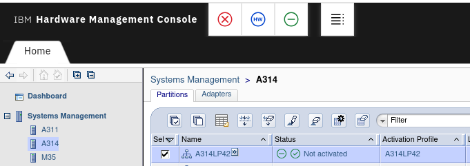
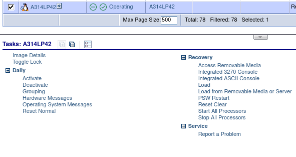
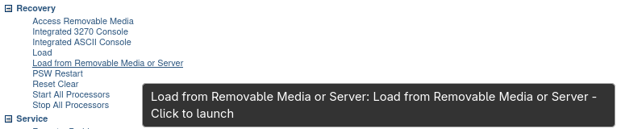
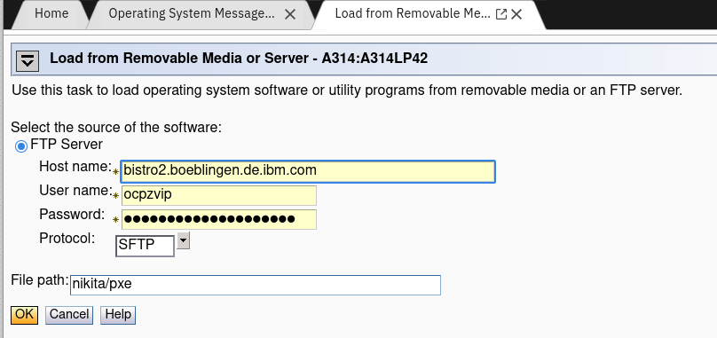
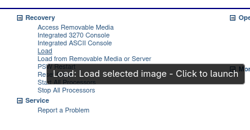
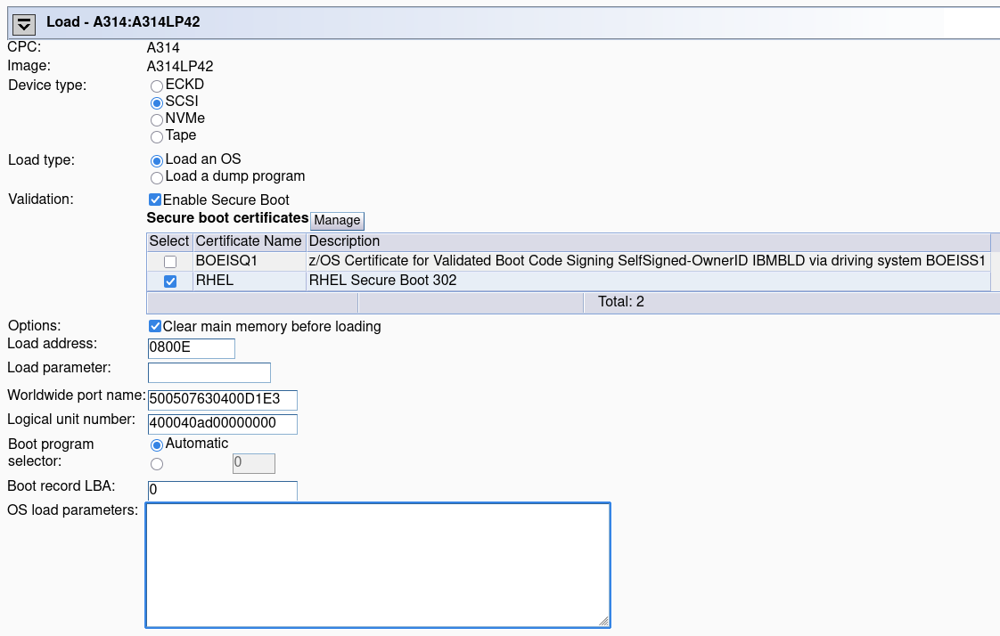
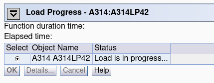

# LPAR: Installing Red Hat CoreOS with Secure IPL

---

## Installing RHCOS on LPAR

### Prerequisites

- Access to the HMC
- An FTP server accessible from the HMC to provide the initial boot files
  (SFTP and FTPS are also supported)

### Preparing the Ignition file

You need to create the Ignition file before starting the installation.

### Preparing the FTP Server

Upload the installation files to the FTP server:

1. Download the ISO of the latest stable RHCOS.
2. Mount the ISO file:
    ```
    $ mount -o loop rhcos-9.8.20260625-dev0-live-iso.s390x.iso iso/
    ```
3. Check `generic.ins` and copy the files listed there to `/path/to/ftp`:
    ```
    $ cat iso/generic.ins
    * minimal lpar ins file
    images/pxeboot/vmlinuz 0x00000000
    images/pxeboot/initrd.img 0x02000000
    images/genericdvd.prm 0x00010480
    images/initrd.addrsize 0x00010408
    ```
    ```
    $ cp iso/generic.ins ftp/
    $ mkdir -p ftp/images/pxeboot
    $ cp iso/images/pxeboot/vmlinuz ftp/images/pxeboot/
    $ cp iso/images/pxeboot/initrd.img ftp/images/pxeboot/
    $ cp iso/images/genericdvd.prm ftp/images/
    $ cp iso/images/initrd.addrsize ftp/images/
    ```

4. Update the kernel parameter file (`ftp/images/genericdvd.prm`).

    Example:
    ```
    $ cat ftp/images/genericdvd.prm
    cio_ignore=all,!condev rd.neednet=1 rd.znet=qeth,0.0.1140,0.0.1141,0.0.1142,layer2=1,portno=0 ip=172.23.236.42::172.23.0.1:255.255.0.0:coreos:enc1140:none nameserver=172.23.0.1 zfcp.allow_lun_scan=0 rd.zfcp=0.0.800e,0x500507630400d1e3,0x400040ad00000000 coreos.inst.install_dev=/dev/sda coreos.inst.insecure=yes coreos.inst.ignition_url=http://172.23.236.43/configs/ignition.ign coreos.live.rootfs_url=http://172.23.236.43/rhcos-9.8.20260625-dev0-live-rootfs.s390x.img
    ```

    Your file tree on the FTP server should now look like this:
    ```
    $ tree
    .
    ├── generic.ins
    └── images
        ├── genericdvd.prm
        ├── initrd.addrsize
        └── pxeboot
            ├── initrd.img
            └── vmlinuz
    ```

### Select your LPAR

  
  

### HMC: Install RHCOS on LPAR

1. Select "Load from Removable Media or Server" under the "Recovery" menu.

   

2. Set your FTP server and boot.

   

---

## Enabling Secure IPL on an Installed System

1. Log in to Red Hat CoreOS and verify the output:
    ```
    $ cat /sys/firmware/ipl/has_secure
    1
    ```
2. Power off CoreOS:
    ```
    [core@coreos ~]$ sudo poweroff

    Broadcast message from root@coreos on pts/1 (Wed 2026-07-08 10:37:20 UTC):

    The system will power off now!
    ```
3. In the HMC, enable Secure Boot and boot CoreOS:
   - Select "Load" from the LPAR's recovery menu.

     

   - Enable the "Enable Secure Boot" option and verify the certificate is valid.

     

   - Load the system.

     

---

## Verifying Secure IPL Is Active

Preferred way to check whether Secure IPL is in use:
```
$ cat /sys/firmware/ipl/secure
1
```

An alternative check via `dmesg`:
```
$ dmesg | grep "Secure-IPL enabled"
[    0.029829] setup: Linux is running with Secure-IPL enabled
```

## Additional Resources

- <https://www.ibm.com/docs/en/linux-on-systems?topic=linux-secure-boot>
- <https://www.ibm.com/docs/en/linux-on-systems?topic=certificates-lpar>
